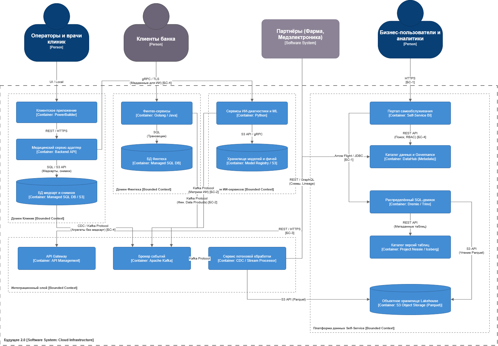

### 1. Поддержка ключевых бизнес-сценариев в целевой архитектуре (`ToBe`)

* **[БС-1] Быстрая подготовка отчётности (Self-Service):**
* Разделение хранения (`S3 Object Storage`) и вычислений (`Dremio / Trino`) в рамках **Data Lakehouse** ускоряет запросы по сотням терабайт данных и убирает многочасовое ожидание отчётов.

* **Портал самообслуживания (Self-Service BI)** и **Каталог данных (DataHub)** позволяют сотрудникам всех подразделений самостоятельно находить дата-продукты и собирать отчёты по нужным срезам без привлечения команды хранилища.

* **[БС-2] Независимое развитие финтех- и ИИ-направлений:**
* По принципам **Data Mesh** и **DDD** клиники, финтех и ИИ выделены в изолированные облачные домены (`Bounded Contexts`) со своими БД и бизнес-логикой.

* Бизнес-логика перенесена из центрального DWH в доменные сервисы, а обмен данными идёт через публикацию **Data Products** по контрактам через брокер событий (`Apache Kafka`), что сокращает *time-to-market*.

* **[БС-3] Масштабирование и подключение новых бизнесов (фармкомпании, производители медэлектроники):**
* Замена старой шины `ESB Apache Camel` на **API Gateway** и **Apache Kafka** позволяет подключать новых партнёров по единым контрактам без изменения ядра платформы данных.

* Облачная инфраструктура обеспечивает эластичное масштабирование ресурсов под рост нагрузки и объёма данных.

* **[БС-4] ИБ, отказоустойчивость и соблюдение требований регуляторов:**
* Медкарты, истории болезней и снимки изолированы в БД домена клиник и **не попадают** в общую аналитическую витрину; в ИИ-сервисы они передаются только по защищённому каналу.

* **DataHub** и **Self-Service BI** обеспечивают ролевой контроль доступа (RBAC), аудит и отслеживание происхождения данных (*Data Lineage*), защищая медицинскую и банковскую тайну.

* Геораспределённое развёртывание и бэкапы в облаке повышают отказоустойчивость критичных систем.

* **Работа с легаси на горизонте 1 года:**
* Монолитный DWH (`SQL Server 2008`) и шина `ESB Apache Camel` выводятся из эксплуатации (`Retire`).

* Клиентское приложение клиник на `PowerBuilder` временно сохраняется (`Retain` на 1 год), но отвязывается от старого DWH и переводится на работу с изолированной БД клиник через медицинский API-адаптер.

---

### 2. Проблемные места текущего ландшафта (`As-Is`) и их влияние на бизнес

* **П-1. Монолитный DWH перегружен бизнес-логикой и сотнями терабайт данных:**
* *Проявление:* тяжёлые трансформации внутри единого `SQL Server 2008`, в который вшита логика клиник, финтеха и ИИ.

* *Влияние на бизнес:* сложные отчёты строятся часами (задержка управленческих решений), а любая доработка для новых продуктов тормозит из-за «бутылочного горлышка» в команде DWH (рост *time-to-market*).

* **П-2. Устаревший технологический стек и жёсткая связность (`SQL Server 2008`, `PowerBuilder`, кастомный `Power BI`):**
* *Проявление:* неподдерживаемая СУБД, прямая привязка интерфейса врачей к DWH и перегруженный кастомизациями BI-слой.

* *Влияние на бизнес:* высокие риски простоев клиник, рост затрат на поддержку легаси-оборудования и невозможность для бизнес-пользователей самостоятельно строить новые срезы отчётов.

* **П-3. Централизованная шина `ESB Apache Camel` как единая точка связности:**
* *Проявление:* весь межсервисный и междоменный обмен завязан на устаревшую ESB.

* *Влияние на бизнес:* высокая сложность и риск регрессий при подключении новых партнёров (фармкомпаний и производителей медэлектроники).

* **П-4. Смешение медицинских, финансовых и операционных данных в одном DWH без гранулярного управления доступом:**
* *Проявление:* медкарты, банковские счета и общая отчётность лежат в одном хранилище без единого каталога и автоматизированных политик доступа.

* *Влияние на бизнес:* критические риски утечек и нарушения 152-ФЗ, врачебной и банковской тайны при открытии самообслуживания для сотрудников.

* **П-5. Отсутствие единого каталога данных и прозрачности владения (Data Ownership):**
* *Проявление:* нет централизованного поиска, глоссария и описаний датасетов.

* *Влияние на бизнес:* сотрудники тратят время на ручной поиск данных и согласование доступов, снижается доверие к отчётности.

---

### 3. Приоритизация проблем по методу MoSCoW

* **Must have (Критично для запуска целевой архитектуры через год, ИБ и выживания бизнеса):**
* *Изоляция медкарт и финансовых данных + внедрение RBAC-контроля (П-4):* исключает попадание медкарт в витрину и обеспечивает соблюдение требований регуляторов (152-ФЗ, банковская и врачебная тайна).

* *Миграция в облако и декомпозиция DWH на доменные БД и Data Lakehouse (П-1, П-2):* устраняет многочасовые задержки отчётов, снимает риски отказа `SQL Server 2008` и обеспечивает отказоустойчивость.

* *Запуск портала самообслуживания и базового каталога данных (П-2, П-5):* закрывает главную цель руководства — дать подразделениям инструмент самостоятельного построения отчётов.

* **Should have (Важно для скорости роста, выручки и масштабирования в течение года):**
* *Вынос бизнес-логики из DWH в доменные сервисы и внедрение контрактов Data Products (П-1):* ускоряет *time-to-market* и позволяет независимо развивать финтех и ИИ.

* *Замена `ESB Apache Camel` на `API Gateway` и `Apache Kafka` (П-3):* открывает быстрое подключение фармкомпаний и производителей медэлектроники в экосистему.

* **Could have (Желательно, развивается итеративно после запуска ядра платформы):**
* *Автоматический Data Lineage, расширенный бизнес-глоссарий и автотесты качества данных (П-5):* повышают доверие к витрине и ускоряют онбординг аналитиков, но не блокируют базовый запуск через год.

* **Won't have (Исключено из скоупа первого года):**
* *Переписывание клиентского интерфейса клиник на `PowerBuilder` (П-2 — фронтенд):* интерфейс остаётся на 1 год (`Retain`) через API-адаптер к новой БД клиник, чтобы не рисковать остановкой работы врачей и сроками миграции данных.
