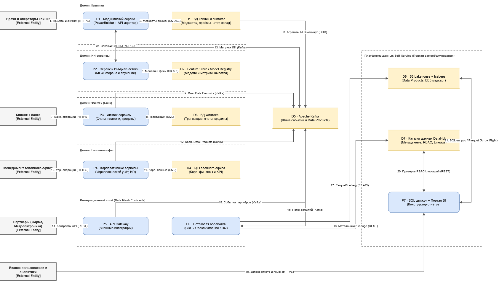

# 1. Разделение системы на домены (по принципам Data Mesh и DDD)

Чтобы избавиться от вшивания бизнес-логики в единый DWH и обеспечить независимое развитие направлений, система разделена на 4 бизнес-домена (по организационной структуре компании) и сквозную платформу данных самообслуживания:

* **Домен «Клиники» (`P1`, `D1`):**
* *Зона ответственности:* операционная работа клиник, приёмы пациентов, медицинские карты, истории болезней, результаты исследований и снимки, учёт персонала и инвентаризация больниц.

* *Обоснование:* изоляция чувствительных медицинских данных (152-ФЗ, врачебная тайна) в отдельном контуре с собственной БД `D1` и API-адаптером `P1` (к которому временно подключён клиент на `PowerBuilder`). Медкарты и истории болезней **не публикуются** в общую витрину.

* **Домен «ИИ-сервисы» (`P2`, `D2`):**
* *Зона ответственности:* диагностические ML-модели, инференс по медицинским данным и снимкам, хранение весов моделей и фичей.

* *Обоснование:* быстрые эксперименты и обновление Python-сервисов `P2` без влияния на операционную БД клиник и без перегрузки центрального хранилища.

* **Домен «Финтех (Банк)» (`P3`, `D3`):**
* *Зона ответственности:* банковские счета, транзакции, кредитные продукты, финансовая история клиентов.

* *Обоснование:* соблюдение банковской тайны и требований регуляторов, независимый релизный цикл сервисов на `Golang/Java` (`P3`) и хранение транзакционных данных в изолированной БД `D3`.

* **Домен «Головной офис» (`P4`, `D4`):**
* *Зона ответственности:* корпоративный управленческий учёт, консолидированная финансовая отчётность, HR и общекорпоративные KPI.

* *Обоснование:* отделение управленческой логики и корпоративных справочников от операционных систем клиник и банка.

* **Интеграционный слой и Платформа данных Self-Service (`P5`–`P7`, `D5`–`D7`):**
* *Зона ответственности:* стандартизированный приём данных от доменов и внешних партнёров (фармацевтических компаний и производителей медэлектроники) по контрактам (`P5`, `D5`, `P6`), хранение дата-продуктов в `S3 Lakehouse` (`D6`), управление доступом и метаданными в `DataHub` (`D7`) и конструктор отчётов в портале самообслуживания (`P7`).

---

## 2. Потоки данных между доменами (`DFD`)

* **Сценарий 1. Анализ медицинских снимков через ИИ и изоляция медкарт:**
* Врачи и операторы клиник передают данные приёмов и снимки через `P1` в изолированную БД `D1` (*потоки 1–2*).

* Для диагностики `P1` отправляет снимки и обезличенные медданные по защищённому каналу (`gRPC`) в ИИ-сервисы `P2` и получает обратно заключение (*потоки 3–4*).

* В общую шину `D5` из `D1` через `CDC` уходят **только обезличенные операционные агрегаты** (загрузка клиник, штат, склад) — медкарты и истории болезней остаются строго внутри `D1` (*поток 6*).

* **Сценарий 2. Независимый запуск и развитие финтех-сервисов:**
* Банковские операции клиентов обрабатываются в `P3` и фиксируются в `D3` без обращения к DWH (*потоки 7–8*).

* Готовые финансовые **Data Products** публикуются по контракту в `Apache Kafka` (`D5`), аналогично с корпоративными данными Головного офиса (`P4`, `D4`) и метриками качества ИИ (`P2`) (*потоки 9–13*).

* **Сценарий 3. Интеграция будущих партнёров (фармкомпании и производители медэлектроники):**
* Новые партнёры подключаются через единый `API Gateway` (`P5`) по стандартизированным REST-контрактам и публикуют свои события в `D5` без доработки ядра платформы (*потоки 14–15*).

* **Сценарий 4. Формирование витрины и самообслуживание сотрудников (Self-Service):**
* Потоковый обработчик `P6` забирает события из `D5`, проверяет контракты качества, записывает дата-продукты в `S3 Lakehouse` (`D6`) и регистрирует схемы и *Data Lineage* в `DataHub` (`D7`) (*потоки 16–18*).

* Бизнес-пользователи всех подразделений через портал самообслуживания `P7` находят дата-продукты в каталоге `D7` (с проверкой ролевого доступа `RBAC`) и конструируют отчёты по любым разрешённым срезам напрямую поверх `D6` (*потоки 19–21*).

---

### 3. Аргументация разделения и преимущества для бизнеса

* **Ускорение вывода продуктов (Time-to-Market):** доменные команды (`Клиники`, `Финтех`, `ИИ`) владеют своей бизнес-логикой и БД («left and shift»), выпуская новые сервисы независимо без очереди на доработку центрального DWH.

* **Снижение зависимости от DWH и устранение «бутылочного горлышка»:** центральная команда данных больше не пишет бизнес-логику за другие подразделения, а развивает инфраструктуру самообслуживания и стандарты контрактов.

* **Быстрое масштабирование экосистемы:** подключение фармкомпаний, производителей медэлектроники и новых бизнес-направлений сводится к подключению нового поставщика дата-продуктов через `API Gateway` и `Kafka` по единым правилам.

* **Соответствие требованиям регуляторов и ИБ:** физическое и логическое разделение контуров исключает попадание медкарт в общую аналитику и обеспечивает гранулярный доступ (`RBAC`) к финансовым данным банка.

* **Прозрачность и доверие к данным:** единый каталог `DataHub` с бизнес-глоссарием, владельцами дата-продуктов и *Data Lineage* сокращает время поиска показателей и исключает дублирование отчётности.
