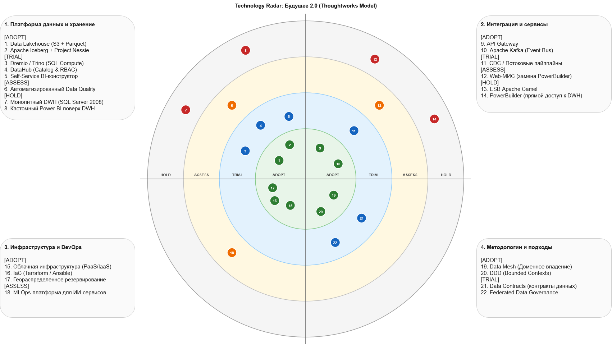

# Задание 3. Технический радар и роадмап изменений («Будущее 2.0»)

## 1. Технический радар (Tech Radar)

Радар построен по методологии **Thoughtworks** и отражает переход компании от монолитного легаси-стека к доменной облачной платформе данных самообслуживания с привязкой к ключевым бизнес-сценариям (`[БС-1]` — быстрая отчётность Self-Service, `[БС-2]` — независимое развитие финтеха и ИИ, `[БС-3]` — подключение новых бизнесов: фарма, медэлектроника, `[БС-4]` — ИБ и регуляторный комплаенс).

### Сектор 1. Платформа данных и хранение

* **Adopt (Принять):**
  * **1. Data Lakehouse (`S3` + `Parquet`):** дешёвое масштабируемое хранение сотен ТБ данных с разделением Storage и Compute для ускорения отчётности и ИИ-аналитики (`[БС-1]`, `[БС-3]`).
  * **2. `Apache Iceberg` + `Project Nessie`:** открытый табличный формат и каталог версий с ACID-транзакциями (`[БС-1]`, `[БС-4]`).

* **Trial (Пробовать):**
  * **3. `Dremio` / `Trino` (SQL Compute):** распределённый SQL-движок для интерактивных запросов поверх Lakehouse (`[БС-1]`).
  * **4. `DataHub` (Data Catalog & RBAC):** единый реестр дата-продуктов, поиск, бизнес-глоссарий, *Data Lineage* и ролевой доступ  (`[БС-1]`, `[БС-4]`).
  * **5. Self-Service BI-конструктор:** единый портал самообслуживания (`[БС-1]`).

* **Assess (Изучать):**
  * **6. Автоматизированный Data Quality:** встроенные проверки качества данных в пайплайнах (`[БС-1]`, `[БС-4]`).

* **Hold (Выводить из эксплуатации):**
  * **7. Монолитный DWH (`Microsoft SQL Server 2008`):** устаревшая СУБД подлежит полному выводу (`Retire`) (`[БС-1]`, `[БС-2]`).
  * **8. Кастомный `Power BI` поверх DWH:** жёстко завязан на схемы старого хранилища, не масштабируется под самообслуживание (`[БС-1]`).

### Сектор 2. Интеграция и сервисы

* **Adopt (Принять):**
  * **9. `API Gateway`:** единая стандартизированная точка входа и авторизации для внешних партнёров (фармкомпании, производители медэлектроники) и доменных сервисов (`[БС-3]`, `[БС-4]`).
  * **10. `Apache Kafka` (Event Bus):** асинхронный обмен событиями между доменами и публикация дата-продуктов (`[БС-2]`, `[БС-3]`).

* **Trial (Пробовать):**
  * **11. CDC / Потоковые пайплайны:** захват изменений из доменных БД (включая обезличенные агрегаты клиник без медкарт) и доставка в Lakehouse в реальном времени (`[БС-1]`, `[БС-4]`).

* **Assess (Изучать):**
  * **12. Web-МИС (замена `PowerBuilder`):** проектирование современного веб-интерфейса для врачей и операторов клиник на горизонте 1+ года (`[БС-2]`, `[БС-4]`).

* **Hold (Удерживать / Выводить):**
  * **13. `ESB Apache Camel`:** централизованная шина заменяется на `API Gateway` и `Kafka` (`Retire`) (`[БС-2]`, `[БС-3]`).
  * **14. Клиент `PowerBuilder` (прямой доступ к DWH):** прямой доступ к DWH запрещается; интерфейс временно сохраняется на 1 год (`Retain`) только через изолированный медицинский API-адаптер (`[БС-4]`).

### Сектор 3. Инфраструктура и DevOps

* **Adopt (Принять):**
  * **15. Облачная инфраструктура (`PaaS` / `IaaS`):** эластичное масштабирование ресурсов под рост данных и быстрое развёртывание изолированных сред для доменов (`[БС-2]`, `[БС-3]`).
  * **16. IaC (`Terraform` / `Ansible`):** декларативное управление облачными ресурсами и воспроизводимость окружений доменов (`[БС-2]`, `[БС-3]`).
  * **17. Геораспределённое резервирование и HA:** отказоустойчивость и бэкапы для критичных медицинских и банковских контуров (`[БС-4]`).

* **Assess (Изучать):**
  * **18. MLOps-платформа для ИИ-сервисов:** стандартизация жизненного цикла и версионирования диагностических моделей на горизонте 1+ года (`[БС-2]`).

### Сектор 4. Методологии и подходы

* **Adopt (Принять):**
  * **19. Data Mesh (Доменное владение):** перенос владения данными и бизнес-логикой из центрального DWH в продуктовые команды доменов (`[БС-2]`, `[БС-3]`).
  * **20. DDD (`Bounded Contexts`):** чёткое разделение границ клиник, финтеха, ИИ и головного офиса для независимых релизов (`[БС-2]`).

* **Trial (Пробовать):**
  * **21. Data Contracts (контракты данных):** формализованные схемы и SLA на публикуемые дата-продукты для безопасного подключения партнёров (`[БС-3]`, `[БС-4]`).
  * **22. Federated Data Governance:** единые политики ИБ, маскирования медкарт и ролевого доступа поверх автономных доменов (`[БС-4]`).

---

## 2. Переход к плану трансформации

Внедрение технологий из колец **Adopt** и **Trial** с поэтапным выводом легаси из кольца **Hold** рассчитано на горизонт 1 года (`Q1–Q4`) с промежуточной вехой через 2–3 месяца (согласование архитектуры и запуск MVP витрины).

Подробный поквартальный план с привязкой к бизнес-целям, командам, ресурсам и экономическим обоснованием представлен в отдельном документе:
* **[Технологический роадмап трансформации «Будущее 2.0» (Q1–Q4)](roadmap.md)**