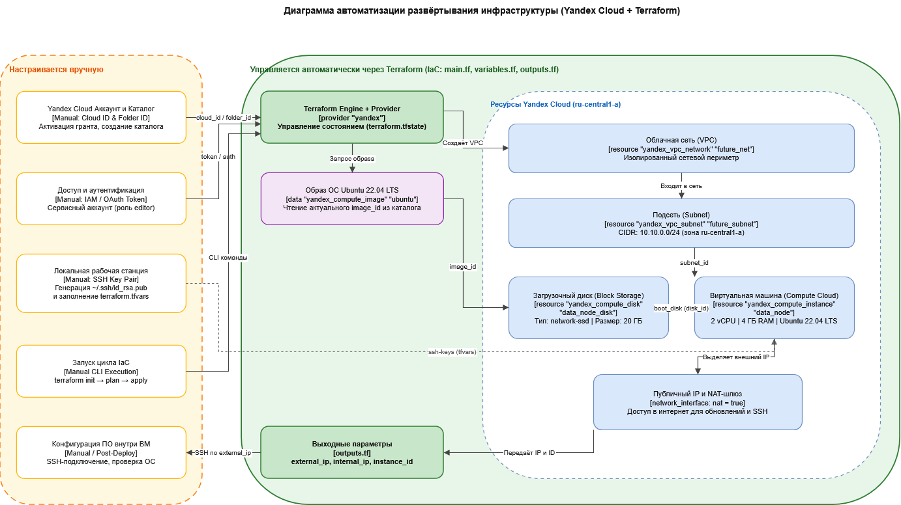

# Обоснование облачной инфраструктуры и применения IaC (`Task4`)

## 1. Архитектура развёртывания

Развёртывание разделено на два контура:
- Ручная подготовка (Manual Prerequisites): создание аккаунта и каталога в Yandex Cloud (`cloud_id`, `folder_id`), выпуск токена сервисного аккаунта и генерация SSH-ключей на машине инженера. Эти действия выполняются один раз при инициализации облачного окружения.

- Автоматизация через Terraform (Managed by Terraform): создание изолированной облачной сети (`yandex_vpc_network`), подсети (`yandex_vpc_subnet`), загрузочного диска (`yandex_compute_disk`) и виртуальной машины (`yandex_compute_instance`) с автоматическим выделением публичного IP (`NAT`).

---

## 2. Обоснование выбора ресурсов и параметров

- Вычислительные ресурсы ВМ (`platform_id = "standard-v3"`, `2 vCPU`, `4 ГБ RAM`, `core_fraction = 100`):
  * Конфигурация `2 vCPU / 4 ГБ RAM` на платформе Intel Ice Lake (`standard-v3`) со 100% гарантированной долей ядра обеспечивает стабильную работу контейнеризированных сервисов платформы данных (API-адаптеров, агентов CDC или лёгких сервисов каталога) без «шумных соседей» и избыточных затрат на старте.
  * Параметры вынесены в переменные `vm_cores` и `vm_memory`, что позволяет за секунды вертикально масштабировать узел под рост нагрузки.

- Дисковая подсистема (`type = "network-ssd"`, `size = 20 ГБ`, образ `ubuntu-2204-lts`):
  * Сетевой SSD (`network-ssd`) выбран вместо `network-hdd` для обеспечения низких задержек ввода-вывода (IOPS) при работе системных служб, Docker-контейнеров и локального кэширования.
  * Объём `20 ГБ` достаточен для базовой ОС Ubuntu 22.04 LTS, системных пакетов и логирования, при этом основные массивы аналитических данных по целевой архитектуре выносятся в объектное хранилище S3.

- Сетевая конфигурация и настройки `NAT` (`10.10.0.0/24`, `nat = true`):
  * Выделение отдельной сети `VPC` и подсети `10.10.0.0/24` изолирует контур проекта от других ресурсов каталога.
  * Включение `nat = true` на сетевом интерфейсе автоматически назначает ВМ публичный IP-адрес, что необходимо для:
    1. первичного администрирования и проверки стенда по протоколу `SSH`;
    2. исходящего доступа в интернет для скачивания обновлений безопасности ОС и образов контейнеров из внешних репозиториев.
  * *(Примечание для продакшн-контура: в промышленной эксплуатации для медицинских и финансовых доменов прямой публичный IP на рабочих ВМ отключается, а доступ организуется через NAT-шлюз, Bastion-хост и группы безопасности Security Groups).*

---

## 3. Причины выбора декларативного подхода (Terraform)

Вместо императивных скриптов (пошаговых CLI-команд `yc compute instance create ...`) использован декларативный подход на языке HCL:
- Фокус на конечном состоянии: инженер описывает *желаемую конфигурацию* инфраструктуры (`main.tf`), а провайдер Terraform сам выстраивает граф зависимостей (сначала сеть -> затем подсеть и диск -> затем ВМ) и определяет порядок вызова API облака.
- Идемпотентность и контроль дрейфа (`terraform.tfstate`): повторный запуск `terraform apply` не создаёт дубликаты серверов, а сравнивает реальное облако с файлом состояния и применяет только дельту изменений (`terraform plan`).
- Минимизация человеческих ошибок: исключаются ручные опечатки в консольных флагах и несогласованность параметров между окружениями.

---

## 4. Как подход IaC обеспечивает воспроизводимость и масштабируемость

- Воспроизводимость (Reproducibility): вся инфраструктура хранится в Git в виде версионируемого кода (`main.tf`, `variables.tf`). При необходимости развернуть идентичный стенд для нового бизнес-домена (например, для интеграции фармкомпании или производителя медэлектроники в «Будущем 2.0») достаточно скопировать конфигурацию или переопределить значения в `terraform.tfvars` — среда поднимется за 1–2 минуты без ручной настройки.
- Масштабируемость (Scalability): параметры ресурсов (число ядер, объём RAM/дисков, количество инстансов через `count` или `for_each`) изменяются в одном месте кода. В сочетании с облачной моделью *Pay-as-you-go* это позволяет быстро наращивать мощности под пиковую аналитическую нагрузку и так же быстро удалять временные тестовые стенды (`terraform destroy`), оптимизируя бюджет компании.